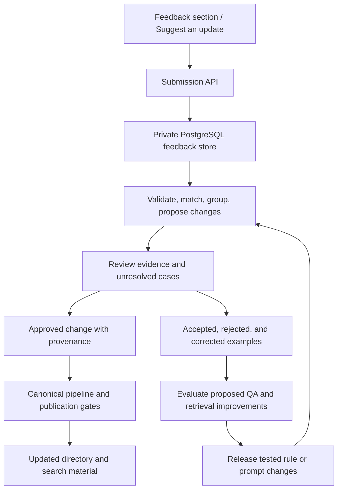

# Community feedback and continuous data improvement

Status: implementation plan, 2026-10-13. Owner: Ben Hankins.
Related policy: [directory maintenance](../data-governance/directory-maintenance.md).

## Problem and outcome

Farm owners and visitors encounter changes that source directories may miss:
closures, new farms, seasonal availability, and incorrect listing details.
FarmFinder currently has no working submission endpoint or private feedback
store. Those observations need a durable path into evidence-backed updates.

Build a public feedback section connected to a backend and a private database.
Use verified outcomes to improve records, QA rules, and future search answers.
Storing feedback alone does not train a model or make submissions true. The
improvement loop must explicitly connect reports, decisions, publication, and
measured changes to system behavior.

## User journeys

- As a visitor, I can report an incorrect detail from a farm profile with that
  farm already selected, so the report reaches the right record.
- As someone with firsthand knowledge, I can add a missing farm or report a
  change without creating an account or finding a public source URL.
- As a farm owner or employee, I can identify my relationship and optionally
  provide a private follow-up email. Claiming that relationship does not verify it.
- As a contributor whose submission failed, I retain my entered text and can
  retry without creating multiple reports.
- As a curator, I can compare a proposed change with current facts and evidence,
  resolve conflicts, and trace a published change back to its report.

## Proposed architecture

Use the planned managed PostgreSQL backend for private submissions, with a
server API and background worker. A database-backed job queue is sufficient
initially; no additional vector database or separate queue service is required
for feedback intake. PostgreSQL supports queue-consumer locking patterns such
as `SKIP LOCKED`; this is for job claims, not public data reads.
[PostgreSQL reference](https://www.postgresql.org/docs/18/sql-select.html).

This is proposed infrastructure, not a description of the current deployment.
The web application currently reads a generated national index. Its hosting
configuration has no D1 or R2 binding, and managed PostgreSQL is not in its
public request path. Provisioning the feedback store does not itself change
the canonical authority or complete the PostgreSQL dataset cutover.

Before cutover, approved changes must be applied to committed state JSON through
the established scoped change and publication workflow. Store public farm IDs
as text and pin the observed dataset release; the planned relational farm IDs
are UUIDs and require an explicit identity map. A missing-farm report can have
no existing farm ID. After cutover, connect approved reports to source records,
field assertions, and audit events in the canonical relational model.

## First release: durable intake and private review (P0)

### Public interface

Add a “Help keep FarmFinder accurate” section and a “Suggest an update” action
on profiles. Offer missing farm, listing correction, closure/reopening,
seasonal change, relocation, duplicate, and other report types.

Required information: farm name, city/state, report type, and what changed.
Capture an existing farm ID automatically when entering from a profile.
Offer relationship to the farm, observation date (including unknown), source
URL, and private follow-up email. Firsthand accounts are valid submissions
without links; an observation is still subject to review. No file uploads in v1.

Use clear labels, keyboard navigation, field-specific errors, and an accessible
success state. Explain that reports are reviewed and reporter contact details
are private. Do not advertise a guaranteed publication date or active monthly
automation before those operations exist.

### Backend and storage

Proposed endpoint: `POST /v1/feedback`. Validate supported types and field
lengths server-side, bound request size, and require a client-generated retry
key. Insert the report and processing job in one transaction. Return an opaque
receipt only after commit. A retry with the same key and payload returns the
same receipt; reuse with different content is rejected. Database failure must
produce a retryable error, not a success message.

Suggested storage responsibilities (final names chosen during implementation):

| Record | Contents and purpose |
|---|---|
| Feedback submission | Original account, farm reference, release ID, report type, relationship, observation/submission dates, evidence links, retry key, processing state |
| Private reporter contact | Optional email, separate access policy and retention; excluded from public feeds and model input |
| Processing job / attempt | Lease, retry count, next attempt, terminal error, worker/rule/model version |
| Proposed field change | Field, current value/version, proposed value, supporting evidence, unresolved conflicts |
| Review event | Decision, reason, actor, evidence, timestamp; append history rather than overwrite decisions |
| Publication link | Applied change, affected farm identity, canonical revision and public release, publish outcome |

Suggested lifecycle: received → triaged → needs review / needs information →
approved / rejected / duplicate → published. Approval and publication are
distinct; an approved report stays pending publication when a build fails.
Retries and processing failures remain visible to operators. Lease jobs for
bounded work, reclaim expired leases, and make processing idempotent.

Use managed backups and verify a restore before opening intake. Curator reads
and decisions require authenticated, authorized server access. The public
endpoint cannot enumerate reports or expose personal information. Apply rate
limits and basic spam filtering; add challenges if observed abuse requires them.
Avoid logging report bodies or emails. Set explicit retention and deletion
rules for contact details and rejected/spam reports before launch; retain
necessary non-personal provenance for approved changes.

### Review and publication

The worker validates fields, matches candidate farms, groups related reports,
and prepares a comparison with the current record. Optional AI can summarize
the account or propose structured fields, using a redacted payload and a
validated output schema. Treat submitted text as data, never tool instructions.
Do not automatically fetch arbitrary submitted URLs in v1; later evidence
fetchers must block private/internal destinations and unsafe redirects.

Human reviewers initially approve all public changes. Prioritize closure,
relocation, and identity conflicts. Verify owner identity before giving an
owner's claim precedence; repeated copies of one report are not independent
corroboration. An unsupported claim can remain unresolved without deleting the
farm or presenting it as confirmed.

Approved changes pass existing eligibility and privacy gates. Check the record
version before applying: a newer conflicting value returns the proposal for
review rather than being overwritten. Record before/after values and evidence,
preserve prior decisions, and retain a reversal path. Rebuild public artifacts
and derived counts only from the approved canonical state.

Integrate unresolved feedback into the existing QA residue workflow, with links
to the private evidence. The authenticated review screen is a richer view of
those cases, not an unrelated competing list of canonical decisions.

### Acceptance criteria

- A valid anonymous report survives a server restart and appears in private review.
- A double click or retry creates one submission and one processing job.
- Database outage preserves the user's form and never shows a false receipt.
- A worker crash is recoverable without duplicate proposals or publications.
- Anonymous and unauthorized users cannot read reports or approve changes.
- Reporter details never appear in public responses, feeds, retrieval, or logs.
- An unverified closure report cannot remove a farm from public discovery.
- A stale approved proposal cannot overwrite a newer conflicting correction.
- A published correction links to its evidence, reviewer, canonical revision,
  and generated release; a failed release retains the last valid public dataset.
- A backup restore recovers submissions and their review/publication state.

## Second release: improve from reviewed outcomes (P1)

Maintain two explicit improvement loops:

1. **Knowledge:** approved corrections update canonical facts and the public
   search material. Future grounded answers retrieve the corrected information
   without retraining a model. Pending or rejected reports remain private.
2. **Behavior:** recurring reviewed errors become test cases and proposals for
   better matching, extraction, QA rules, and retrieval. For example, repeatedly
   confusing seasonal inactivity with permanent closure becomes a regression
   case plus a proposed rule or prompt revision.

Keep training/development examples separate from a held-out evaluation set.
Use reviewed labels, split related farms/reports together to avoid leakage,
redact personal data, and version rules, prompts, and model settings. Compare
candidate behavior against the current baseline, review regressions, deploy
successful changes, and retain rollback. Evaluation should expand as new
real-world failure cases appear.
[Evaluation guidance](https://developers.openai.com/api/docs/guides/evaluation-best-practices).

Automation starts with intake, matching, grouping, and drafting. Later, allow
specific low-risk correction classes to publish automatically only after their
precision has been measured on held-out reviewed cases and their policy is
explicitly enabled. Closures, identity changes, private locations, and disputed
ownership continue to require review. Model confidence alone is insufficient.

Fine-tuning is a separate future decision requiring enough suitable reviewed
examples and demonstrated benefit over rules, prompting, and retrieval.
Neither autonomous code rewriting nor model-weight updates are part of v1.

## Cadence and measurement

Accept reports continuously and process them asynchronously as they arrive.
Review between source refreshes; material confirmed corrections may publish
earlier. The broad source-refresh baseline is monthly, with every other month
acceptable. Review system-improvement candidates during that maintenance cycle.

Measure successful durable submissions, failures, queue age, time from report
to decision and publication, reversal rate, repeated error categories, and
precision by proposed automation class. Monitor worker failures and backlog
growth so accepted reports cannot silently accumulate.

Launch invariants: all acknowledged submissions are durable; all public changes
are traceable; unauthorized reads and private-data leakage fail release tests.
During the first monthly cycle, establish volume and reviewer-capacity baselines.
Proposed pilot targets, subject to that baseline: 95% of valid submission
attempts acknowledged within five seconds, and 90% of reports triaged within
seven days. Measure these from server events; exclude neither failed attempts
nor unresolved cases from the operational dashboard.

Evaluate rule/prompt changes against held-out cases and existing privacy,
closure, identity, and retrieval regressions. Enable automation per change
class only after defining an acceptable error rate and sufficient sample size;
do not invent a universal confidence threshold.

## Implementation order and remaining decisions

1. Backend foundation: choose managed PostgreSQL hosting, deployment connectivity,
   curator authentication, backup/restore, and retention. Keep farm authority unchanged.
2. Ship storage, submission API, feedback section, profile entry points, and
   authenticated review together. Do not ship a form with nowhere to send data.
3. Connect reviewed decisions to the pre-cutover canonical pipeline, public
   artifact regeneration, and QA residue. First fix reconciliation so a source
   refresh cannot erase corrections or silently drop named candidates.
4. Add assisted triage, evaluation fixtures, operational metrics, and monthly
   review of proposed improvements. Add grounded answers through the planned
   structured-query/full-text retrieval path when that capability is implemented.

Keep implementation PRs small and observe exclusive file ownership. Pipeline
schema/reconciliation work belongs to the serial tooling lane; do not run it
alongside overlapping data work. The intake plan can proceed before the full
PostgreSQL canonical cutover, but automatic publication cannot bypass its gates.

Engineering must select the hosting/connection method and authentication before
deployment. The product owner must assign the review operator and set retention
before accepting live reports. These are implementation decisions, not blockers
to this plan. No deadline, vendor purchase, deployment, or scheduled job is
created by this document.
